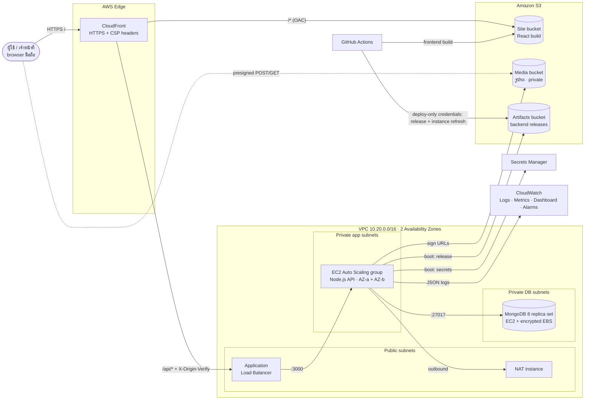

# SciPark บน AWS

ระบบทั้งหมดสร้างจาก CloudFormation template เดียว ([`scipark.yaml`](scipark.yaml))
และ deploy อัตโนมัติด้วย GitHub Actions ([`deploy.yml`](../.github/workflows/deploy.yml))
ทุกอย่างในหน้านี้ทำได้จาก **AWS CloudShell** (เปิดจาก Console มี AWS CLI พร้อมใช้) ไม่ต้องติดตั้งอะไรในเครื่อง

## สถาปัตยกรรม



**เส้นทางข้อมูลหลัก (จองที่จอด):** browser → CloudFront → ALB (เฉพาะ request ที่มี header ลับจาก CloudFront) →
EC2 instance ตัวใดก็ได้ใน 2 AZ → MongoDB ใน private subnet บันทึก transaction → ตอบกลับทางเดิม
เจ้าหน้าที่สแกน QR → instance สร้าง presigned URL ให้รูปรถจาก S3 → browser โหลดรูปจาก S3 โดยตรง

## บริการที่ใช้และเหตุผล

| ชั้น | บริการ | หน้าที่ในระบบ | ทำไมเลือก (เทียบกับทางเลือกอื่น) |
|---|---|---|---|
| CDN | **CloudFront** | ทางเข้าเดียวของระบบ, HTTPS, cache หน้าเว็บ, ส่ง `/api/*` ไป ALB | ได้ HTTPS ฟรีโดยไม่ต้องมีโดเมน; หน้าเว็บและ API อยู่ origin เดียวกัน (cookie แบบ httpOnly ใช้ได้, ไม่ต้องตั้ง CORS) — ถ้าใช้ S3 website ตรง ๆ จะไม่มี HTTPS |
| Static | **S3 (site bucket)** | เก็บ React build | Object storage จ่ายตามที่ใช้ ทนทาน 11 nines ไม่ต้องดูแลเซิร์ฟเวอร์ — EFS (file storage) แพงกว่าและต้อง mount กับเครื่อง ไม่เหมาะกับไฟล์ที่แค่ส่งให้ browser |
| Media | **S3 (media bucket)** | รูปรถที่ผู้ใช้อัปโหลด | browser อัปโหลดตรงด้วย presigned POST ไฟล์ไม่ผ่านและไม่ค้างบน EC2 → compute เป็น stateless จริง |
| Load balancing | **ALB** | กระจาย request ไป instance ที่ health check ผ่าน, drain ก่อนปิดเครื่อง | รองรับ path/header rule (กันคนเข้า ALB ตรง), health check ระดับ HTTP — NLB เป็น L4 ทำ rule แบบนี้ไม่ได้; API Gateway เหมาะกับ Lambda มากกว่า |
| Compute | **EC2 Auto Scaling** (t3.micro × 2 AZ) | รัน Node.js API | ควบคุมได้ทั้งหมด, Free Tier, ขยายตาม CPU, rolling update ด้วย Instance Refresh — Lambda ต้องแยกแอปเป็นฟังก์ชันและ cron/transaction ยาวทำยาก; ECS Fargate สะดวกกว่าแต่แพงกว่าเล็กน้อยและต้องทำ container |
| Database | **MongoDB บน EC2** (private subnet) | ข้อมูลธุรกรรมทั้งหมด (การจอง, ผู้ใช้, แต้ม) | แอปเขียนด้วย MongoDB อยู่แล้ว ไม่ต้องแก้โค้ด, ค่าใช้จ่ายต่ำ — DocumentDB เป็น managed + Multi-AZ แต่ ~US$60+/เดือน; Atlas ฟรีแต่อยู่นอก VPC (ไม่อยู่ใน private subnet) |
| Secrets | **Secrets Manager** | JWT secret, รหัสผ่าน DB (สร้างอัตโนมัติ) | สร้างรหัสผ่านให้ตอน deploy, ไม่มีรหัสในโค้ด/template/disk, IAM คุมว่าใครอ่านได้ — SSM Parameter Store ฟรีกว่าแต่ CloudFormation สร้าง SecureString ไม่ได้ |
| Network | **VPC + NAT instance** | แยก public/private, ให้เครื่อง private ออกอินเทอร์เน็ตได้อย่างเดียว | NAT instance ~US$4/เดือน เทียบ NAT Gateway ~US$35+/เดือน (แลกกับเป็นเครื่องเดียวที่ต้องดูแลเอง, มี auto-recovery) |
| Observability | **CloudWatch** | log ทุก request เป็น JSON, metric ธุรกิจจาก log, dashboard, alarm → email | ใช้บริการเดียวครบ ไม่ต้องตั้ง Prometheus/Grafana เอง, อยู่ใน Free Tier |
| CI/CD | **GitHub Actions** | test → release → rolling deploy อัตโนมัติ | ใช้ OIDC (token ชั่วคราว 1 ชม. ไม่มี key) ถ้าบัญชีอนุญาต; บัญชีนี้ SCP ห้ามสร้าง OIDC provider จึงใช้ IAM user ที่มีสิทธิ์แค่ deploy — CodePipeline ทำได้เหมือนกันแต่ตั้งค่าเยอะกว่า |

## ความปลอดภัย

- **เครือข่าย:** EC2 ของแอปและ MongoDB อยู่ใน private subnet ไม่มี public IP ไม่มีพอร์ต SSH เปิด (เข้าเครื่องด้วย SSM Session Manager)
  - Security group ต่อกันเป็นชั้น: CloudFront → ALB:80 → App:3000 → DB:27017 แต่ละชั้นรับจากชั้นก่อนหน้าเท่านั้น
  - ALB รับเฉพาะ IP ของ CloudFront (managed prefix list) และ request ต้องมี header `X-Origin-Verify` ที่ถูกต้อง ไม่อย่างนั้นได้ 403
- **รหัสลับ:** JWT secret และรหัสผ่าน MongoDB สร้างโดย Secrets Manager ตอน deploy แอปอ่านผ่าน IAM role ตอนบูต (`backend/config/secrets.js`) — ไม่มีไฟล์ `.env` บนเครื่อง
  - Role ของแอปอ่านได้เฉพาะ secret ของแอป ไม่ใช่ของ admin DB, เขียน S3 ได้เฉพาะ `vehicles/*`
- **ข้อมูล:** EBS เข้ารหัส, S3 บล็อก public ทั้งหมด + เข้ารหัส, รูปรถดูได้ผ่าน presigned URL ที่หมดอายุใน 15 นาที
- **HTTP:** HTTPS บังคับที่ CloudFront, HSTS, CSP, cookie `Secure`+`HttpOnly`, IMDSv2 บังคับบนทุกเครื่อง
- **CI/CD:** GitHub ได้สิทธิ์แค่ publish release + instance refresh + invalidate CDN (อ่าน secret, แก้ IAM, เข้า DB ไม่ได้)
  - แบบ OIDC: เฉพาะ branch `main` ของ repo นี้, token อายุ 1 ชม.
  - แบบ access key (เมื่อ SCP ห้าม OIDC เช่นบัญชีนี้): key เก็บเป็น GitHub encrypted secret, ส่งมอบผ่าน Secrets Manager ไม่ผ่าน output, ควร rotate เป็นระยะ

## ความพร้อมใช้งานและการขยายตัว

- App 2 instance ใน 2 AZ หลัง ALB: AZ หนึ่งล่ม อีก AZ ยังให้บริการ; instance ตายจะถูกแทนอัตโนมัติ (health check แบบ ELB)
- ขยายอัตโนมัติเมื่อ CPU เฉลี่ยเกิน 60% (สูงสุด 4 instance)
- **Stateless:** rate limit และ lock ของ cron job เก็บใน MongoDB (ไม่อยู่ใน memory ของเครื่อง), ไฟล์อยู่ใน S3, session เป็น JWT → instance ไหนตอบก็ได้ ถูกแทนเมื่อไหร่ก็ได้
- **Zero-downtime deploy:** Instance Refresh แบบ MinHealthy 100% / MaxHealthy 200% = เปิดเครื่องใหม่ให้ผ่าน health check ก่อน แล้วค่อย drain (20 วินาที) และปิดเครื่องเก่า
- **Database:** เครื่องเดียว (จุดเสี่ยงที่ยอมรับเพื่อคุมงบ) ลดความเสี่ยงด้วย:
  - EC2 auto-recovery เมื่อฮาร์ดแวร์เสีย (IP และ volume เดิม)
  - ข้อมูลอยู่บน EBS แยก + snapshot รายวันเก็บ 7 วัน + snapshot สุดท้ายตอนลบ stack
  - ทางขยาย: เพิ่ม replica set เป็น 3 node ใน 3 AZ หรือย้ายไป DocumentDB

## ค่าใช้จ่ายโดยประมาณ (ap-southeast-2, ต่อเดือน, เปิด 24 ชม.)

ตัวเลขประมาณการ ควรยืนยันกับ [AWS Pricing Calculator](https://calculator.aws/) และหน้า Billing → Free Tier ของบัญชี

| รายการ | ไม่มี Free Tier | หมายเหตุ |
|---|---|---|
| ALB | ~$19 | Free Tier แบบเดิม (12 เดือน) ฟรี 750 ชม. |
| EC2 app t3.micro × 2 | ~$19 | ใช้ 1 เครื่องตอนปกติ เหลือ ~$10 |
| EC2 MongoDB t3.micro | ~$10 | Free Tier แบบเดิม ฟรี 750 ชม. (รวมทุกเครื่อง) |
| NAT instance t4g.micro | ~$7 | |
| Public IPv4 (ALB 2 + NAT 1) | ~$11 | |
| EBS ~42 GB + snapshot | ~$5 | Free Tier 30 GB |
| Secrets Manager × 3 | ~$1.2 | |
| CloudFront, S3, CloudWatch | ~$0–2 | อยู่ในโควตาฟรีเกือบทั้งหมด |
| **รวม** | **~$65–70** | 1 app instance: ~$55; ใช้ Free Tier แบบเดิมได้: ~$25–35 |

### บัญชี Free plan (เครดิต)

บัญชีที่สมัครหลังกลางปี 2025 ใช้ **Free plan**: ได้เครดิต (เช่น $100) ใช้ได้ 6 เดือน แทน Free Tier 12 เดือนแบบเดิม
ค่าใช้จ่ายด้านบนจะถูกหักจากเครดิต — ถ้าเปิด 2 instance ตลอด 24 ชม. **เครดิต $100 จะหมดในประมาณ 1.5 เดือน**
และเมื่อเครดิตหมดหรือครบกำหนด บัญชีจะหยุดให้บริการจนกว่าจะอัปเกรดเป็นแบบจ่ายเงิน

แผนที่แนะนำเพื่อให้เครดิตพอถึงวันเดโม:
- ช่วงพัฒนา: `scale.sh 1` และ `pause.sh` ทุกครั้งที่เลิกใช้ (กลางคืน/วันที่ไม่ได้ทำ)
- ช่วงซ้อมและวันเดโม: `resume.sh 2`
- ตั้ง `MonthlyBudgetUsd` ให้ต่ำกว่าเครดิตที่เหลือต่อเดือน และดูเครดิตคงเหลือที่ Billing → Credits ทุกสัปดาห์
- Free plan ใช้ได้ **region เดียว** ที่บัญชีถูกกำหนดไว้ (บัญชีนี้คือ Sydney ap-southeast-2) สคริปต์ทั้งหมดจึงตั้งค่าเริ่มต้นเป็น Sydney — เปลี่ยนได้ด้วย `AWS_REGION=...`
- Free plan อาจให้ใช้ได้เฉพาะ instance type ที่อยู่ใน Free Tier (t3.micro, t3.small, t4g.micro, …) ค่าเริ่มต้นของ template จึงใช้แต่ขนาดเหล่านี้

**การคุมงบ:**
- AWS Budget (สร้างโดย template) ส่งอีเมลเมื่อใช้ถึง 50% / 80% และเมื่อคาดว่าจะเกิน 100% ของ `MonthlyBudgetUsd`
- ใช้ 1 instance ตอนพัฒนา (`scale.sh 1`) และ 2 ตอนเดโม (`scale.sh 2`)
- ปิดเครื่องตอนไม่ใช้ด้วย `pause.sh` (เหลือแค่ ALB + EBS + IPv4 ~$1/วัน) แล้วลบ stack หลังจบวิชา
- Log เก็บ 14 วัน, release เก่าใน S3 ลบอัตโนมัติหลัง 60 วัน, custom metrics 8 ตัว (ไม่เกินโควตาฟรี 10)

## ติดตั้งครั้งแรก

ทำครั้งเดียว ใช้เวลาประมาณ 30 นาที (ส่วนใหญ่รอ CloudFront และ MongoDB)

**1. สร้าง stack หลัก** (ใน CloudShell, region ap-southeast-2)

```bash
git clone https://github.com/hhonn/SciPark_System.git && cd SciPark_System
./infra/scripts/deploy-stack.sh you@example.com
```

กดยืนยันอีเมล "AWS Notification - Subscription Confirmation" เพื่อรับ alarm
ครั้งแรก app จะเริ่มที่ 0 เครื่อง เพราะยังไม่มี release ให้รัน

**2. ให้ GitHub deploy ได้** — ใช้ [`github-deploy.yaml`](github-deploy.yaml) แบบใดแบบหนึ่ง

*แบบ OIDC (ดีที่สุด ไม่มี key เก็บไว้):*

```bash
aws cloudformation deploy --region ap-southeast-2 --stack-name scipark-github \
  --template-file infra/github-deploy.yaml --capabilities CAPABILITY_NAMED_IAM \
  --parameter-overrides AuthMode=oidc GitHubRepo=hhonn/SciPark_System
```

GitHub → Settings → Secrets and variables → Actions → **Variables**: `AWS_REGION`=`ap-southeast-2`,
`STACK_NAME`=`scipark-prod`, `AWS_DEPLOY_ROLE_ARN`=output `DeployRoleArn`

*แบบ access key (บัญชี Free plan: SCP ห้าม `iam:CreateOpenIDConnectProvider`):*

```bash
aws cloudformation deploy --region ap-southeast-2 --stack-name scipark-github \
  --template-file infra/github-deploy.yaml --capabilities CAPABILITY_NAMED_IAM \
  --parameter-overrides AuthMode=accesskey
aws secretsmanager get-secret-value --region ap-southeast-2 \
  --secret-id /scipark-prod/github-deploy-key --query SecretString --output text
```

GitHub → **Variables**: `AWS_REGION`=`ap-southeast-2`, `STACK_NAME`=`scipark-prod` (ไม่ต้องมี `AWS_DEPLOY_ROLE_ARN`)
GitHub → **Secrets**: `AWS_ACCESS_KEY_ID` และ `AWS_SECRET_ACCESS_KEY` จากคำสั่งสุดท้าย
แล้วลบ secret ใน AWS ทิ้งได้: `aws secretsmanager delete-secret --region ap-southeast-2 --secret-id /scipark-prod/github-deploy-key --force-delete-without-recovery`

**3. Deploy ครั้งแรก:** GitHub → Actions → Deploy → Run workflow (หรือ push เข้า `main`)

**4. เปิดเครื่อง app:** `./infra/scripts/scale.sh 2`

**5. ข้อมูลเริ่มต้น** (เข้าเครื่อง app: EC2 → instance → Connect → Session Manager)

```bash
# ข้อมูลตัวอย่าง (ฐานข้อมูลใหม่เท่านั้น: seed ลบข้อมูลเดิมทั้งหมด)
# บน production ต้องตั้งรหัสผ่านบัญชีทดสอบเอง ไม่ใช้รหัสใน README
sudo SEED_USER_PASSWORD='<รหัสยาว>' SEED_ADMIN_PASSWORD='<รหัสยาวอีกชุด>' \
  /opt/scipark/bin/run scripts/seed.js --force
```

หรือย้ายข้อมูลจากเครื่องเดิม — ดูหัวข้อถัดไป

**6. ใส่ค่าอีเมล (ถ้ามี SMTP):** Secrets Manager → `/scipark/prod/app` → แก้ JSON เพิ่ม `EMAIL_USER`, `EMAIL_PASS`, `EMAIL_FROM`
และ `"REQUIRE_EMAIL_VERIFICATION": "true"` แล้ว restart ด้วย `./infra/scripts/scale.sh` หรือ Instance Refresh

## ย้ายข้อมูลจาก EC2 เดิม (scipark-kmitl.duckdns.org)

```bash
# บนเครื่องเดิม: dump แล้วส่งขึ้น S3 (bucket = ArtifactsBucketName ใน Outputs)
mongodump --uri "$MONGO_URI" --gzip --archive=scipark.archive.gz
aws s3 cp scipark.archive.gz s3://<ArtifactsBucketName>/migration/scipark.archive.gz

# บนเครื่อง MongoDB ใหม่ (Session Manager):
aws s3 cp s3://<ArtifactsBucketName>/migration/scipark.archive.gz /tmp/
ADMIN=$(aws secretsmanager get-secret-value --secret-id /scipark/prod/db-admin --query SecretString --output text)
mongorestore --gzip --archive=/tmp/scipark.archive.gz --drop \
  --uri "mongodb://admin:$(echo "$ADMIN" | jq -r .password)@127.0.0.1:27017/?authSource=admin&directConnection=true" \
  --nsFrom 'scipark.*' --nsTo 'scipark.*'   # ถ้า DB เดิมชื่ออื่น เช่น test.* ให้แก้ --nsFrom

# แล้วบนเครื่อง app:
sudo /opt/scipark/bin/run scripts/secureSeed.js --apply --fix-spots
sudo /opt/scipark/bin/run scripts/migrate.js --apply
```

DuckDNS ชี้ไปที่ CloudFront ไม่ได้ (รองรับแค่ A record) ระบบใหม่จึงใช้ URL `https://dxxxx.cloudfront.net` จาก Outputs
ถ้าต้องการโดเมนของตัวเอง ต้องมีโดเมนจริง + ใบรับรอง ACM ใน us-east-1

## ใช้งานประจำวัน

| ต้องการ | ทำ |
|---|---|
| Deploy โค้ดใหม่ | push เข้า `main` (หรือ Run workflow) |
| ดู dashboard | ลิงก์ `DashboardUrl` ใน Outputs |
| ค้น log | CloudWatch → Logs Insights → `/scipark/prod/app` เช่น `filter event = "booking_created"` |
| ตั้งเจ้าหน้าที่ | หน้า `/app/admin` หรือ `sudo /opt/scipark/bin/run scripts/setRole.js staff <email>` |
| ปิดชั่วคราว / เปิด | `./infra/scripts/pause.sh` / `./infra/scripts/resume.sh 2` |
| Rollback | ตั้ง SSM parameter `/scipark/prod/release` เป็น SHA เดิม แล้ว Start instance refresh |
| ลบทั้งหมด | `aws cloudformation delete-stack --stack-name scipark-prod` (MongoDB volume ถูกเก็บเป็น snapshot; ลบ S3 bucket ให้ว่างก่อน) |

## เดโมสำหรับนำเสนอ

**Zero-downtime deploy:** เปิด 2 terminal

```bash
./infra/scripts/watch-health.sh https://dxxxx.cloudfront.net     # terminal 1
# terminal 2: push commit ใดก็ได้เข้า main หรือ Run workflow
```

terminal 1 จะเห็น `release` เปลี่ยนจาก commit เก่าเป็นใหม่, `instance` เปลี่ยนเป็นเครื่องใหม่ทีละเครื่อง และ `failed` ต้องเป็น 0 ตลอด

**High availability:** EC2 → เลือก app instance เครื่องหนึ่ง → Terminate → `watch-health.sh` ยังได้ 200 (ALB ส่งไปอีก AZ)
แล้ว Auto Scaling สร้างเครื่องใหม่แทนใน ~3 นาที (ดูได้ใน dashboard ช่อง Healthy instances)

**Observability:** dashboard แสดง request, error, p95 latency, จำนวนจอง/เช็คอินจาก log, และตาราง request ต่อ instance (เห็นการกระจายโหลด)
